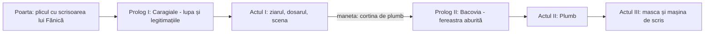

# Implementation Guide v2 — „Scrisoarea & Plumbul”
### Extensie: Portretele autorilor + conținut literar complet (Caragiale × Bacovia)
**Autor proiect:** David Rentea, clasa a XII-a E

> [!IMPORTANT]
> **Pentru AI-ul care implementează:** Acest ghid **extinde** proiectul existent din `E:\rom` (v1). Nu rescrie de la zero. Ce e marcat **[NOU]** se adaugă, ce e marcat **[ÎNLOCUIEȘTE]** suprascrie conținutul v1. Tot textul literar din §10 se copiază **verbatim** (diacritice cu virgulă: ș ț). Fără bullet-uri seci: fiecare idee apare ca obiect fizic (hârtie, bilet, sticlă, metal, cerneală).

---

## 0. Decizii

| Întrebare | Decizie |
|---|---|
| Rădăcina proiectului | `E:\rom` |
| Stack | Același: HTML/CSS/JS vanilla, GSAP 3.12.5 + Draggable + ScrollTrigger (CDN), Web Audio sintetizat |
| Unde stau portretele autorilor | **Caragiale** = „Prolog” la începutul Actului I (lume zgomotoasă). **Bacovia** = „Prolog” la începutul Actului II, imediat după cortina de plumb. Așa tranziția comic → apăsător rămâne una singură și memorabilă (maneta). |
| Fișiere noi | `css/prolog.css`, `js/prolog-caragiale.js`, `js/prolog-bacovia.js` |
| Server | `uv run python -m http.server 5173` în `E:\rom` |

### Fluxul nou


---

## 1. Creditul autorului — „David Rentea, clasa a XII-a E” [NOU]

Numele apare **diegetic** (ca obiect din lume), nu ca footer de site:

| Loc | Formă |
|---|---|
| Plic (poarta) | colț stânga-sus, Homemade Apple, mic: „Expeditor: David Rentea, cl. a XII-a E” |
| Ziar (masthead) | în `.masthead-subtitle`, înlocuiește „Director-Proprietar: Nae Cațavencu” cu „Redactor: David Rentea, clasa a XII-a E” |
| Fereastra Bacovia | zgâriat discret în colțul ramei, ca o inscripție cu unghia: „D.R. — XII E” |
| Actul III | semnătura finală: „Jurnal de lectură — David Rentea, clasa a XII-a E” |
| `<title>` | `Scrisoarea & Plumbul — Jurnal de lectură · David Rentea, XII E` |

---

## 2. Poarta — scrisoarea devine chiar scrisoarea lui Fănică [ÎNLOCUIEȘTE parțial]

Fișier: `index.html` → `#letter`, `css/gate.css`.

- Păstrează mecanica de tragere (60px vizibili, `maxPull 260`, snap-back).
- Înlocuiește `.letter-body-preview` cu **textul integral al scrisorii** (§10.2 A, „Intriga”), scris cu Homemade Apple, 15px, culoare `--ink`, ușor înclinat (`rotate(-0.6deg)`). Partea de sus (vizibilă din plic) arată doar „Scumpa mea Zoe,” — restul se dezvăluie pe măsură ce tragi.
- Sub scrisoare, în Courier mic: „— scrisoare pierdută, găsită de cetățeanul turmentat —” (element de decor, nu citat).
- Bonus: pe măsură ce `p` (progresul tragerii) crește peste 0.5, o pată de cerneală roșie apare pe colțul scrisorii (`opacity: (p-0.5)*2`) — semn că scrisoarea „arde” în mâini.

---

## 3. Prolog I — I.L. Caragiale: „Simț enorm și văz monstruos” [NOU]

Plasare: primul element din `#act1`, **deasupra** `.newspaper`, dar în interiorul elementului care cade la manetă (ca să cadă împreună cu ziarul). Recomandare: înfășoară `prolog-caragiale` + `.newspaper` într-un `<div class="act1-falling">` și țintește-l pe acesta în `dropCurtain()`.

### 3.1 Decorul
Un **birou de redacție din 1884**: tăblie verde de postav (`#2f3b2a` + noise), o lampă cu gaz (con cald de lumină), o pagină de ziar veche, un călimar, un monoclu/lupă de alamă. Titlu gravat pe o plăcuță de alamă:

```
I.L. CARAGIALE (1852–1912)
Maestrul Comediei și al Realismului Clasic
```

### 3.2 Mecanica A — „Lupa care demască” (Viziunea despre lume)
- Pe postav stă o pagină de ziar cu text **cuminte, oficial** (decor, Courier estompat, ex.: „Onorabilii noștri reprezentanți veghează neobosiți asupra binelui public...”).
- Utilizatorul trage o **lupă de alamă** (`Draggable`, `type:"x,y"`, `bounds` = pagina). În interiorul lentilei, prin `clip-path: circle(r at x y)` pe un al doilea strat identic poziționat deasupra, apare **textul real**: paragraful „Viziunea despre lume” din §10.1 (Caragiale), cu cuvintele-cheie subliniate în roșu: *corupția politicienilor, demagogia, prostia solemnă, șantajul*.
- Lentila are aberație: `backdrop-filter: contrast(1.3) sepia(.3)` + reflex de sticlă (`radial-gradient` alb la 30% opacitate).
- Când lupa a „scanat” ≥70% din suprafață (grilă invizibilă 6×4 de celule bifate), stratul real rămâne permanent vizibil, cu o ștampilă: „VĂZ MONSTRUOS”. Sunet: `AudioEngine.stamp()`.
- Citatul „Simț enorm și văz monstruos” stă gravat pe mânerul lupei.
- Fallback tastatură/click: buton mic „Privește prin lupă” → animă lupa pe un traseu în S peste pagină (`MotionPath` nu e necesar; 6 tween-uri succesive).

### 3.3 Mecanica B — „Teancul de legitimații” (Cine a fost și epoca sa)
Un teanc de **4 legitimații de carton** prinse cu o agrafă, fiecare cu foto-medalion sepia (siluetă CSS), ștampilă și semnătură:

| Legitimație | Text pe față |
|---|---|
| ZIARIST | „Presa” |
| SUFLEUR | „Teatrul” |
| REVIZOR ȘCOLAR | „Ministerul Instrucțiunii” |
| DIRECTOR AL TEATRULUI NAȚIONAL DIN BUCUREȘTI | „Teatrul Național” |

- Click/drag spre dreapta pe legitimația de sus → zboară într-o parte (`x: 260, rotation: 14`, `paperFlip()`) și se așază într-un al doilea teanc. După ultima, apare dedesubt **fișa completă** cu cele trei paragrafe „Cine a fost și epoca sa” (§10.1), inclusiv mențiunile despre cei patru Mari Clasici și „Junimea”.
- Detaliu Junimea: o mică insignă de ceară cu „J” lângă paragraful despre Titu Maiorescu.

### 3.4 Mecanica C — „Ruloul de bilete” (Reperele operei)
- Un **rulou de bilete de teatru** (cilindru CSS cu `repeating-linear-gradient`) la marginea biroului. Tragi de capătul benzii (`Draggable type:"x"`, bounds 0 → 4 bilete); fiecare bilet perforat care iese este o comedie:
  1. „O noapte furtunoasă”
  2. „Conu Leonida față cu reacțiunea”
  3. „O scrisoare pierdută” (1884) — bilet **auriu**, ștampilat „PREMIERĂ”, cu o săgeată de cerneală „→ Actul I”
  4. „D-ale carnavalului”
- Sub rulou, **două sertare** de birou cu mânere de alamă:
  - Sertarul cu **mască de comedie**: schițele „Vizită...”, „Dl. Goe...”, „Bubico”.
  - Sertarul cu **mască de tragedie**: nuvelele „În vreme de război”, „O făclie de Paște”.
  - Deschidere: `y` → tragere spre utilizator (`scaleY` perspectivă + umbră), sunet de lemn (noise lowpass 250Hz, 0.12s — adaugă `AudioEngine.drawer()`).
- Frazele introductive din §10.1 „Reperele operei sale” se afișează integral pe o etichetă de hârtie lipită deasupra ruloului.

### 3.5 Ieșire din Prolog I
La final, o săgeată de cerneală desenată (SVG `stroke-dashoffset`) duce de la biletul auriu „O scrisoare pierdută” în jos spre masthead-ul ziarului. ScrollTrigger: când prologul iese din viewport, lampa cu gaz pâlpâie o dată.

---

## 4. Actul I — conținut actualizat [ÎNLOCUIEȘTE textele]

Fișier: `index.html` → `#act1`. Layout-ul v1 rămâne. Se schimbă **textele** cu cele din §10.2 și se adaugă un modul.

### 4.1 Articolul principal
`lead-headline` → „Datele Operei și Încadrarea”. În `.article-columns`, câte un paragraf pentru: **Specia și curentul**, **Trăsătura 1**, **Trăsătura 2** (text §10.2 A). **Șterge** frazele de umplutură scrise în v1 după textul obligatoriu (nu inventăm informații).

### 4.2 Editorialul
`.boxed-editorial` → „Tema centrală” (§10.2 A).

### 4.3 [NOU] Modulul „Intriga — Obiectul-pretext”
Între editorial și dosar: un **plic deschis prins cu o pioneză** pe ziar. Click → plicul se rotește, scrisoarea lui Fănică se desfășoară (`scaleY 0 → 1`, origine sus) cu textul complet al citatului în Homemade Apple; dedesubt, în Courier, fraza de context („Scrisoarea ajunge la adversarul politic Nae Cațavencu...”). Pe colț, o amprentă de deget murdară (radial-gradient gri) — „mâna lui Cațavencu”.

### 4.4 Dosarul Tipătescu (3 carduri)
Aceeași mecanică. Texte noi din §10.2 B. Pe cardul III, **„Trăsătura morală dominantă:”** în roșu, urmat de textul aferent. Statutul moral include acum „pentru care este gata să renunțe chiar și la carieră”.

### 4.5 Scena — cele două scene, cu semnificații duble
Fiecare `.scene-pane` primește, după „Schiță scenică” (rămâne marcată ca ilustrativă), **trei blocuri** în format de caiet de regie:

| Bloc | Aspect |
|---|---|
| *Ce se întâmplă:* | text normal |
| *Semnificația pentru operă:* | notă pe margine, cerneală albastră (`--stamp-blue`), pe o fâșie de hârtie lipită |
| *Semnificația pentru personaj:* | notă pe margine, cerneală roșie (`--red-ink`) |

Notele de margine apar cu un „scris de mână” (reveal pe lățime cu `clip-path: inset(0 100% 0 0) → inset(0 0 0 0)`) după ce didascaliile s-au colorat.

### 4.6 Telegramele
Textele noi din §10.2 D (Didascaliile; Titlul operei).

---

## 5. Tranziția — neschimbată, cu o adăugare
`dropCurtain()` țintește acum `.act1-falling` (prolog + ziar). După ce cortina de plumb dispare, **Prologul II** este primul lucru vizibil. Opțional: picăturile de ploaie din canvas încep să se prelingă pe ecran **înainte** ca fereastra Bacovia să apară, ca și cum privitorul ar sta deja în spatele geamului.

---

## 6. Prolog II — George Bacovia: „Fereastra aburită” [NOU]

Plasare: primul element din `#act2`, deasupra `.poem-header`.

### 6.1 Decorul
O **fereastră de provincie** (ramă de lemn vopsit, scorojit, 4 ochiuri), noapte, ploaie. În spatele geamului: siluetele unui parc pustiu și ale unui felinar (CSS, tonuri `--lead`). Geamul este **aburit** (strat alb-gri `rgba(201,205,211,.55)` + `backdrop-filter: blur(6px)`). Pe pervaz: o carte groasă, cenușie, cu titlul „PLUMB — 1916”.

### 6.2 Mecanica A — „Șterge aburul” (Cine a fost și epoca sa)
- Peste geam: un `<canvas>` cu aburul. La `pointermove` cu butonul apăsat se desenează cu `globalCompositeOperation = "destination-out"` (pensulă moale, 38px) → apare textul de sub geam.
- Textul de sub geam = cele două paragrafe „Cine a fost și epoca sa” (§10.1 Bacovia), Cormorant Garamond italic, `--fog`.
- **Aburul revine încet**: la fiecare 120ms, canvas-ul primește un strat `fillRect` cu opacitate 0.012 → textul se încețoșează din nou dacă nu ștergi. *Asta e ideea: nimic nu rămâne limpede la Bacovia.* După ce s-a șters ≥65% (eșantionare `getImageData` pe grilă de 20px, throttled la 400ms), aburul nu mai revine și apare o picătură care se prelinge pe geam.
- Sunet: frecare de sticlă la ștergere (noise bandpass 1.8kHz, Q 6, volum după viteză — `AudioEngine.glassWipe(speed)`).
- **Numele:** pe geam, cu degetul, scrie singur (animare SVG `stroke-dashoffset` pe un path handwriting) „Gheorghe Vasiliu”, care apoi se scurge (`filter: blur` + `y` 20px, opacity 0) și lasă loc lui „George Bacovia” — legătura cu „pe numele său adevărat Gheorghe Vasiliu, s-a născut la Bacău”.
- Fallback accesibil: buton „Șterge geamul” → animă o ștergere automată în zig-zag.

### 6.3 Mecanica B — „Cartea de plumb” (Viziunea despre lume)
- Cartea de pe pervaz e **grea**: la drag în sus se ridică abia (`Draggable type:"y"`, `edgeResistance: .95`, bounds 0 → -40px) și cade înapoi cu `bounce.out` și `AudioEngine.clunk()` dacă nu e trasă până la capăt; click o deschide direct.
- Deschisă (rotateY copertă -160°, `perspective`), arată pe două pagini paragrafele „Viziunea despre lume și universul poetic” (§10.1). Imaginile enumerate — *ploaia nesfârșită, frigul, vântul, toamna târzie, parcul pustiu, cavoul* — sunt fiecare un `<span class="bv-image">`; hover/focus pe ele face ca **decorul din spatele geamului** să reacționeze: ploaia se întețește, frunzele cad, felinarul pâlpâie, cavoul apare în ceață etc.

### 6.4 Mecanica C — „Cele patru călimări” (Specificul stilului / culorile obsesive)
- Pe pervaz: **4 călimări de sticlă** cu cerneală: cenușiu/plumb, galben, negru, violet.
- Click pe o călimară → cerneala „se varsă” în tot Prologul II: un overlay `mix-blend-mode: color` cu nuanța respectivă se extinde din punctul de click (`clip-path: circle(0 → 150%)`), iar pe o fâșie de hârtie apare semnificația exactă din §10.1:
  - cenușiul/plumbul (greutatea sufletească și lipsa de scăpare)
  - galbenul (boala și deznădejdea)
  - negrul (moartea)
  - violetul (nevroza și apăsarea)
- Fraza introductivă „Înlocuiește explicația directă cu sugestia, simbolul și muzicalitatea interioară monotonă.” stă scrisă pe eticheta cutiei cu călimări.
- Fiecare călimară are notă sonoră proprie (`AudioEngine.bell()`): plumb 98Hz, galben 123.47Hz, negru 65.41Hz, violet 116.54Hz (dizonant intenționat).
- Ultima culoare aleasă **rămâne** ca nuanță a ploii; după ce au fost încercate toate 4, culoarea revine definitiv la **cenușiu** — și apare săgeata „↓ Plumb”.

### 6.5 Paletă nouă (tokens) — adaugă în `base.css`
```css
--bv-yellow: #b8a24a;
--bv-black:  #0b0b0d;
--bv-violet: #4b3a5c;
--window-wood: #3a3128;
--steam: rgba(201, 205, 211, .55);
```
> [!NOTE]
> Violetul e folosit **doar** ca cerneală vărsată în Prologul II, desaturat, cu `mix-blend-mode: color` — nu ca gradient de UI.

---

## 7. Actul II — „Plumb” cu conținut actualizat [ÎNLOCUIEȘTE textele]

Mecanica v1 (6 blocuri de plumb, note descendente, vignetă, panouri de marmură, panoul ★) rămâne. Se actualizează maparea și textele (§10.3):

| # | Cuvânt | Panou |
|---|---|---|
| 1 | sicriele de plumb | Specia și curentul |
| 2 | flori de plumb (S1) | Imaginea 1 – Cavoul și lumea exterioară (citat-cheie + semnificație) |
| 3 | coroanele de plumb | Trăsătura 1 (Simbolul central și sugestia) |
| 4 | amorul meu de plumb | Imaginea 2 – Moartea iubirii și lumea interioară (citat-cheie + semnificație) |
| 5 | flori de plumb (S2) | Trăsătura 2 (Muzicalitatea interioară monotonă) |
| 6 | aripile de plumb | Tema centrală |
| ★ | automat după 6 | Elemente de compoziție: 1. Titlul operei, 2. Organizarea simetrică în două strofe |

- Panourile de imagine afișează *Citat-cheie* în Cormorant italic mare, apoi *Semnificație* în Courier.
- Contorul de jos (6 greutăți) primește eticheta: „de șase ori (de trei ori în fiecare strofă)” — legat direct de Trăsătura 1.

---

## 8. Actul III — „Masca și coala” [ÎNLOCUIEȘTE textul din v1 §8]

### 8.1 Mecanica — masca care cade
- Deasupra mașinii de scris atârnă de un cui o **mască de comedie** (alb-fildeș, zâmbet larg, SVG cu umbre), legată cu o sfoară.
- La scroll (ScrollTrigger `scrub`): sfoara se tensionează, masca se rotește, apoi **cade** (`y: 70vh, rotation: 200, ease: "power2.in"`) și se sparge în 5 cioburi (5 `clip-path`-uri din același SVG, fiecare cu propriul vector). Sunet: `AudioEngine.clunk()` + noise highpass scurt (ceramică).
- În spatele măștii rămâne **o față goală de plumb** (ovale gri, fără trăsături, `--lead-mid` metalic). Imaginea vizuală a reflecției: *la Caragiale — măștile; la Bacovia — omul fără mască, singur*.

### 8.2 Coala bătută la mașină
Titlu: **REFLECȚIE COMPARATIVĂ FINALĂ — Două moduri opuse de a privi criza omului în lume**

Coala este împărțită de mașina de scris în **două coloane**, scrise pe rând (stânga, apoi dreapta), cu un clopoțel de car între ele:
- Coloana stângă (sub cioburile măștii): **La I.L. Caragiale (Lumea măștilor sociale)** + paragraful din §10.4.
- Coloana dreaptă (sub fața de plumb): **La George Bacovia (Lumea izolării interioare)** + paragraful din §10.4.
- Pe mobil: o singură coloană, în aceeași ordine.

Panglica mașinii: **roșie** pentru coloana Caragiale, **neagră-cenușie** pentru coloana Bacovia (schimbă `color` caracterelor tastate).

Semnătură (Homemade Apple): „Jurnal de lectură — David Rentea, clasa a XII-a E”.

> [!WARNING]
> Textul din v1 („În «O scrisoare pierdută», criza este una exterioară și publică...”) **se șterge**. Se folosește exclusiv textul din §10.4.

---

## 9. Audio — funcții noi în `audio.js`

| Funcție | Rețetă |
|---|---|
| `drawer()` | noise lowpass 250Hz, 0.12s + sine 70Hz 0.08s (lemn) |
| `glassWipe(speed)` | noise bandpass 1.8kHz, Q 6, 0.06s, vol `min(.15, speed/400)`, throttle 50ms |
| `gasFlicker()` | noise bandpass 600Hz, 0.3s, volum modulat aleator (pâlpâit de lampă) |
| `ceramicBreak()` | 3 rafale noise highpass 3kHz, decalate 20–40ms, 0.05s fiecare |

Toate respectă regula din v1: return dacă `ctx` lipsește sau e mut.

---

## 10. Conținut exact (copiază verbatim)

### 10.1 SECȚIUNEA 1: PREZENTAREA CELOR DOI AUTORI CANONICI

#### I.L. CARAGIALE (1852–1912) – Maestrul Comediei și al Realismului Clasic

**Cine a fost și epoca sa:**
- Este cel mai mare dramaturg din literatura română și unul dintre cei patru Mari Clasici din a doua jumătate a secolului al XIX-lea, alături de Mihai Eminescu, Ion Creangă și Ioan Slavici.
- A făcut parte din celebra societate literară „Junimea”, condusă de criticul Titu Maiorescu, unde și-a citit marile piese de teatru.
- A avut meserii care l-au pus în contact direct cu toate categoriile sociale: a fost ziarist, sufleur, revizor școlar și director al Teatrului Național din București.

**Viziunea despre lume („Simț enorm și văz monstruos”):**
- Spirit extrem de lucid și ironic, Caragiale a fost un observator neiertător al societății românești moderne.
- A criticat prin râs și satiră defectele epocii sale: corupția politicienilor, demagogia, prostia solemnă, șantajul și dorința oamenilor de a părea mai cultivați sau mai importanți decât sunt în realitate.

**Reperele operei sale:**
- Este creatorul comediei românești de moravuri prin patru piese celebre: „O noapte furtunoasă”, „Conu Leonida față cu reacțiunea”, „O scrisoare pierdută” (1884) și „D-ale carnavalului”.
- Pe lângă comedii, a scris schițe pline de umor („Vizită...”, „Dl. Goe...”, „Bubico”) și nuvele tragice, psihologice („În vreme de război”, „O făclie de Paște”).

#### GEORGE BACOVIA (1881–1957) – Poetul Simbolismului Românesc

**Cine a fost și epoca sa:**
- Pe numele său adevărat Gheorghe Vasiliu, s-a născut la Bacău și este cel mai important reprezentant al simbolismului în literatura română, la începutul secolului al XX-lea.
- A avut o fire retrasă, solitară și extrem de sensibilă, marcată de atmosfera apăsătoare și monotonă a orașului de provincie.

**Viziunea despre lume și universul poetic:**
- A debutat editorial în anul 1916 cu volumul „Plumb”, care dă și titlul celei mai cunoscute poezii a sale.
- Poezia lui Bacovia nu descrie o natură frumoasă sau ocrotitoare, ci proiectează în lumea de afară o mare suferință sufletească: ploaia nesfârșită, frigul, vântul, toamna târzie, parcul pustiu și cavoul devin imagini ale unui suflet captiv și singur.

**Specificul stilului său (Simbolismul):**
- Înlocuiește explicația directă cu sugestia, simbolul și muzicalitatea interioară monotonă.
- Folosește câteva culori obsesive cu rol de simbol: cenușiul/plumbul (greutatea sufletească și lipsa de scăpare), galbenul (boala și deznădejdea), negrul (moartea) și violetul (nevroza și apăsarea).

---

### 10.2 SECȚIUNEA 2: I.L. CARAGIALE – „O SCRISOARE PIERDUTĂ” (OPERA ȘI PERSONAJUL ȘTEFAN TIPĂTESCU)

#### A. Datele Operei și Încadrarea
- **Specia și curentul:** Comedie de moravuri (genul dramatic), reprezentativă pentru realismul clasic din a doua jumătate a secolului al XIX-lea (1884).
- **Trăsătura 1 (Comicul de moravuri și critica societății):** Autorul ridiculizează politicienii corupți din provincie și arată cum aceștia își folosesc funcțiile publice doar pentru a-și păstra puterea și privilegiile nemeritate.
- **Trăsătura 2 (Specificul teatral):** În text nu există un narator; acțiunea este prezentată direct prin dialogul viu dintre personaje și prin notațiile autorului (didascalii).
- **Tema centrală:** Viața politică și lupta necinstită pentru putere, strâns legată de tema corupției și a moralei de familie.
- **Intriga (Obiectul-pretext):** Pierderea unei scrisori de dragoste trimise de prefectul Ștefan Tipătescu către Zoe Trahanache (soția liderului politic local, Zaharia Trahanache): *„Scumpa mea Zoe, venerabilul merge deseară la întrunire. Eu trebuie să stau acasă, pentru că aștept depeși de la București. Nu mă aștepta, prin urmare, și vino tu la cocoșelul tău, care te adoră, ca totdeauna, și te sărută de o mie de ori, Fănică”*. Scrisoarea ajunge la adversarul politic Nae Cațavencu, care o folosește ca armă de șantaj pentru a obține postul de deputat.

#### B. Construcția Personajului Principal: Prefectul Ștefan Tipătescu
- **Statutul social:** Este prefectul județului, un moșier bogat și un politician influent, care conduce administrația și poliția locală ca pe propria moșie, după propriile interese.
- **Statutul psihologic:** Este un om impulsiv, nervos și autoritar, care își pierde repede răbdarea atunci când este amenințat, dar este dominat de dragostea secretă pentru Zoe Trahanache.
- **Statutul moral:** Este corupt și abuziv în viața politică, deoarece folosește funcția publică și jandarmii în interes personal, însă rămâne sincer și loial în relația de iubire cu Zoe, pentru care este gata să renunțe chiar și la carieră.
- **Trăsătura morală dominantă:** Corupția și tendința de a abuza de putere atunci când se simte amenințat.

#### C. Cele Două Scene Semnificative (pentru Operă și Personaj)
**Scena 1 – Șantajul din biroul prefectului:**
- *Ce se întâmplă:* Nae Cațavencu vine în biroul lui Ștefan Tipătescu și îi cere sprijinul pentru a fi ales deputat. El amenință că, în caz contrar, va publica în ziar scrisoarea de dragoste trimisă de prefect către Zoe.
- *Semnificația pentru operă:* Arată că în societate viața politică se bazează pe minciună, compromis și șantaj murdar.
- *Semnificația pentru personaj:* Arată că Tipătescu este impulsiv, își pierde cumpătul și dă ordin să fie arestat ilegal Cațavencu pentru a-și salva funcția și imaginea.

**Scena 2 – Discursurile electorale din sala primăriei:**
- *Ce se întâmplă:* Candidații țin discursuri pline de prostie, demagogie și cuvinte fără sens, iar adunarea electorală se termină cu o bătaie generală între susținători.
- *Semnificația pentru operă:* Ilustrează ridicolul clasei politice și arată că alegerile sunt doar un circ organizat pentru păcălirea cetățenilor naivi.
- *Semnificația pentru personaj:* Evidențiază viclenia lui Tipătescu, care manevrează poliția și voturile din umbră pentru a-și păstra puterea.

#### D. Elemente de Structură și Compoziție
1. **Notațiile autorului (Didascaliile):** Oferă indicații scenice prețioase despre decor, gesturi, tonul nervos și reacțiile personajelor. Ele ajută la transpunerea scenică a piesei și scot în evidență firea impulsivă a lui Tipătescu și ipocrizia politicienilor.
2. **Titlul operei („O scrisoare pierdută”):** Numește obiectul-pretext al luptei politice. Rezumă intriga piesei și arată cum o simplă scrisoare de dragoste pierdută declanșează tot haosul politic și criza prefectului în fața șantajului.

---

### 10.3 SECȚIUNEA 3: GEORGE BACOVIA – „PLUMB” (ANALIZA POEZIEI)

#### A. Textul Integral al Poeziei (1916)
```
Dormeau adânc sicriele de plumb,
Și flori de plumb și funerar vestmânt —
Stam singur în cavou... și era vânt...
Și scârțâiau coroanele de plumb.

Dormea întors amorul meu de plumb
Pe flori de plumb, și-am început să-l strig —
Stam singur lângă mort... și era frig...
Și-i atârnau aripile de plumb.
```

#### B. Datele Operei, Încadrarea și Tema
- **Specia și curentul:** Artă poetică simbolistă, apărută la începutul secolului al XX-lea, în volumul de debut „Plumb” (1916).
- **Trăsătura 1 (Simbolul central și sugestia):** Cuvântul „plumb” este repetat obsesiv de șase ori (de trei ori în fiecare strofă) și sugerează o stare sufletească de greutate, apăsare și tristețe fără ieșire.
- **Trăsătura 2 (Muzicalitatea interioară monotonă):** Ritmul monoton al versurilor și repetarea sunetelor închise transmit cititorului o senzație apăsătoare de frig și de pustiu sufletesc.
- **Tema centrală:** Singurătatea și izolarea totală a omului într-o lume rece, strâns legată de tema morții și a sfârșitului iubirii.

#### C. Cele Două Imagini Poetice Reprezentative
**Imaginea 1 – Cavoul și lumea exterioară (Strofa I):**
- *Citat-cheie:* „Dormeau adânc sicriele de plumb” / „Stam singur în cavou... și era vânt...”
- *Semnificație:* Vocea poetică descrie un spațiu închis, un cavou înghețat și întunecat, unde totul pare împietrit, iar vântul sporește sentimentul de singurătate. Această imagine sugerează blocarea omului într-o lume ostilă, din care nu există nicio posibilitate de salvare.

**Imaginea 2 – Moartea iubirii și lumea interioară (Strofa a II-a):**
- *Citat-cheie:* „Dormea întors amorul meu de plumb” / „Și-i atârnau aripile de plumb.”
- *Semnificație:* Vocea poetică își privește iubirea pierdută ca pe un trup neînsuflețit și încearcă să o strige în zadar, în timp ce aripile acesteia atârnă grele spre pământ. Momentul ilustrează dispariția oricărei speranțe și arată că până și dragostea a murit.

#### D. Elemente de Compoziție și Structură
1. **Titlul operei („Plumb”):** Este format dintr-un singur substantiv nearticulat, care denumește un metal greu, rece și de culoare cenușie. Titlul rezumă atmosfera sumbră a textului și sugerează greutatea apăsătoare care strivește sufletul.
2. **Organizarea simetrică în două strofe:** Prima strofă prezintă lumea exterioară și cavoul rece, iar a doua strofă prezintă lumea interioară și moartea iubirii. Această simetrie arată cum tristețea din jur cuprinde treptat tot sufletul, fapt ce demonstrează că nu există scăpare nici în afară, nici înăuntru.

---

### 10.4 SECȚIUNEA 4: REFLECȚIE COMPARATIVĂ FINALĂ

**Două moduri opuse de a privi criza omului în lume:**
- **La I.L. Caragiale (Lumea măștilor sociale):** Criza este exterioară și zgomotoasă. Pierderea unei scrisori demască corupția, șantajul și abuzul de putere al lui Ștefan Tipătescu, însă totul se termină printr-o împăcare falsă și veselă, care ascunde defectele societății sub masca comediei.
- **La George Bacovia (Lumea izolării interioare):** Criza este mută și profund sufletească. Omul nu mai poartă măști sociale și nu mai luptă pentru putere, ci se retrage singur într-un univers închis și înghețat, unde greutatea „plumbului” stinge orice speranță.

---

## 11. Accesibilitate & responsive (adăugiri)
- Fiecare mecanică nouă are alternativă click/tastatură: „Privește prin lupă”, „Răsfoiește legitimațiile”, „Derulează biletele”, „Șterge geamul”, „Deschide cartea”; călimările și sertarele sunt `<button>`.
- `prefers-reduced-motion`: lupa dezvăluie textul instant; aburul nu revine; masca dispare cu fade, fără cădere/spargere.
- Sub 700px: biroul Caragiale devine stivă verticală (pagina + lupa → legitimații → rulou → sertare); fereastra Bacovia are 2 ochiuri în loc de 4, călimările pe un rând orizontal scrollabil.

---

## 12. Ordinea implementării
1. Credite (§1) + scrisoarea din poartă (§2).
2. Actualizează textele Actului I (§4) și ale Actului II (§7) — rulează scriptul de verificare a textelor (extins cu §10).
3. Prolog I Caragiale (§3): decor → lupă → legitimații → rulou + sertare.
4. Înfășoară prologul + ziarul în `.act1-falling`, actualizează `dropCurtain()` (§5).
5. Prolog II Bacovia (§6): fereastră → abur canvas → nume → carte → călimări.
6. Actul III (§8): masca + coala în două coloane + text nou.
7. Funcțiile audio noi (§9).
8. Responsive / reduced-motion / tastatură (§11).
9. Pornește serverul: `uv run python -m http.server 5173` în `E:\rom`.

---

## 13. Checklist de acceptanță
- [ ] Numele „David Rentea, clasa a XII-a E” apare pe plic, în masthead, pe ramă și în semnătura finală.
- [ ] Scrisoarea din poartă conține citatul exact „Scumpa mea Zoe, ... Fănică”.
- [ ] Prolog Caragiale: lupa dezvăluie viziunea; 4 legitimații (ziarist, sufleur, revizor școlar, director al Teatrului Național din București); 4 comedii pe bilete; schițele și nuvelele în cele două sertare.
- [ ] Prolog Bacovia: aburul se șterge și revine; „Gheorghe Vasiliu” → „George Bacovia”; cartea grea se deschide; 4 călimări cu semnificațiile exacte, revenire finală la cenușiu.
- [ ] Toate cele 21 de itemi din §10.2 și §10.3 sunt prezenți verbatim; fără fraze de umplutură inventate.
- [ ] Scenele au câte 3 blocuri: *Ce se întâmplă / Semnificația pentru operă / Semnificația pentru personaj*.
- [ ] Maneta aruncă prologul + ziarul împreună; după cortina de plumb apare fereastra Bacovia.
- [ ] Actul III: masca de comedie cade și se sparge; coala are cele două coloane din §10.4; textul v1 a fost eliminat.
- [ ] Fără mov SaaS, fără carduri-dashboard, fără bare de progres generice, fără slide-uri.
- [ ] Fără erori în consolă; funcționează în Chrome, Firefox, Edge și pe mobil.
